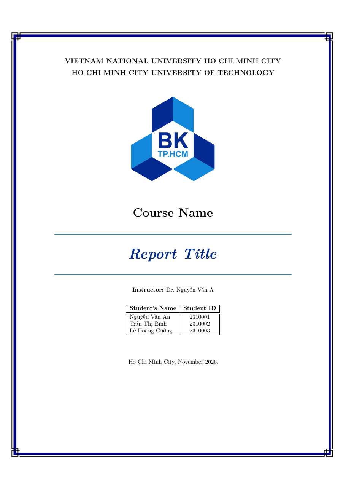
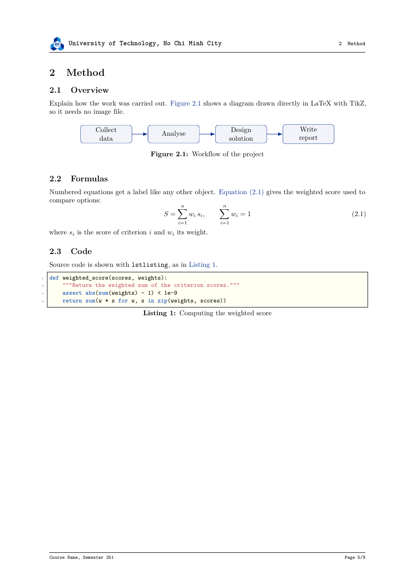
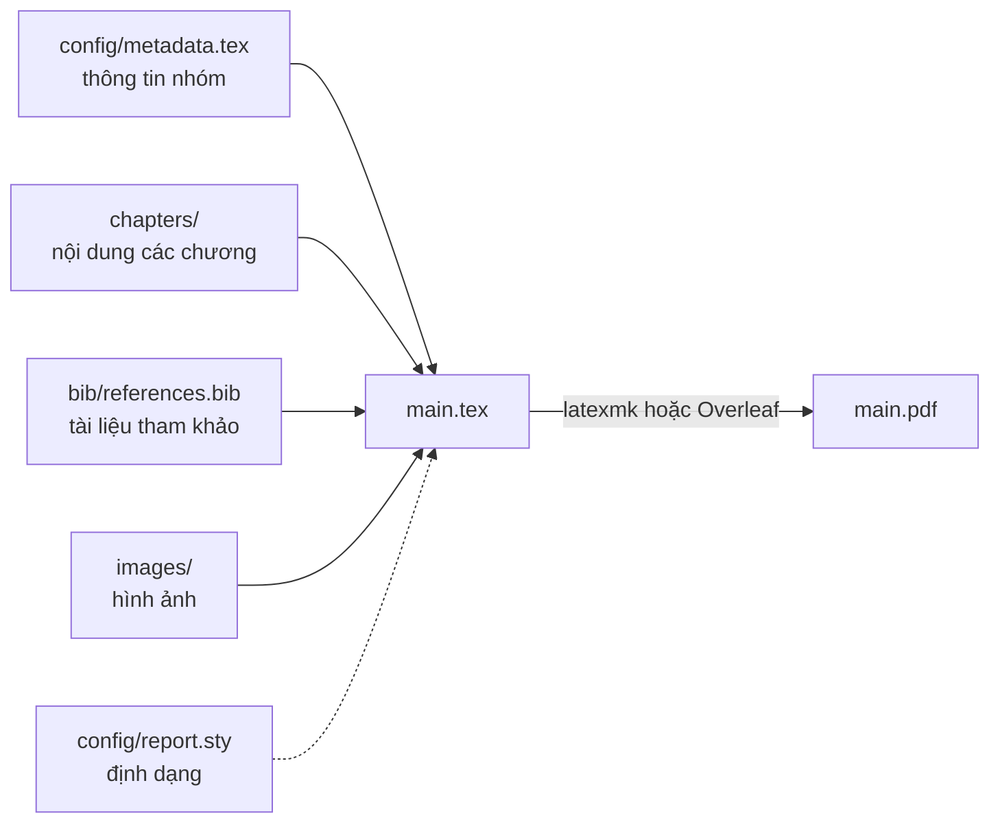

<div align="center">


# Template báo cáo LaTeX cho HCMUT

Template LaTeX cho báo cáo nhóm (bài tập lớn, đồ án môn học) theo khung của Trường Đại học Bách khoa – ĐHQG TP.HCM.

[](LICENSE) [](https://github.com/tienhwng/hcmut-latex-report-template/actions/workflows/build.yml) [](docs/vi/00-bat-dau.md#cài-đặt-trên-máy) [](docs/vi/02-tuy-chon.md#ngôn-ngữ-english--vietnamese)

**Tiếng Việt** | [English](docs/en/README.md)

</div>

Bạn chỉ cần điền thông tin nhóm và viết nội dung. Trang bìa, bảng thành viên, mục lục, header/footer và danh sách tài liệu tham khảo được tạo tự động.

<div align="center">




*Trang bìa và một trang nội dung của bản tiếng Anh (mặc định).*

*Bản tiếng Việt, build với option `vietnamese`: [trang bìa](docs/assets/preview-cover-vi.png) · [trang nội dung](docs/assets/preview-content-vi.png).*

</div>

## Tính năng

- **Trang bìa theo mẫu HCMUT**: logo, ảnh nền, tên môn, tên đề tài, giảng viên, lớp/nhóm và bảng sinh viên.
- **Khai báo thành viên một lần**: danh sách tự xuất hiện ở trang bìa, bảng phân công, bảng đánh giá, trang lời cam đoan và thuộc tính *Author* của PDF.
- **Hai ngôn ngữ**: một option đổi toàn bộ chữ do template sinh ra giữa tiếng Anh và tiếng Việt ("Table 3.1" thành "Bảng 3.1"…).
- **Bản nháp cho cả nhóm**: ghi chú bên lề và chữ chìm DRAFT, tự biến mất ở bản nộp.
- **Tham chiếu và trích dẫn**: tự đánh số, trích dẫn chuẩn IEEE, danh mục từ viết tắt, danh sách hình/bảng, phụ lục.
- **Công cụ đi kèm**: kiểm tra lỗi LaTeX (ChkTeX), soát chính tả tiếng Anh (LTeX+), đếm chữ, build PDF tự động trên GitHub Actions.

## Bắt đầu nhanh

**Trên Overleaf** (không cần cài gì):

1. Nén thư mục template thành file `.zip` (trên GitHub: **Code → Download ZIP**).
2. Trên [overleaf.com](https://www.overleaf.com), chọn **New Project → Upload Project** và chọn file `.zip`.
3. Trong **Menu**, kiểm tra **Compiler** là `pdfLaTeX` và **Main document** là `main.tex`.
4. Bấm **Recompile**.

**Trên máy cá nhân**: cài TeX Live và VS Code, mở thư mục template, cài extension LaTeX Workshop khi được gợi ý, rồi lưu `main.tex` để build. Hướng dẫn từng bước ở [Bắt đầu](docs/vi/00-bat-dau.md).

> [!WARNING]
> Template chỉ chạy với **pdfLaTeX**. XeLaTeX và LuaLaTeX không dùng được với cấu hình font tiếng Việt của template.

Sau khi build được, sửa thông tin nhóm trong `config/metadata.tex` và viết bài trong `chapters/`.

## Cách template hoạt động

Thông tin, nội dung và định dạng nằm ở các file riêng; `main.tex` ghép tất cả lại thành một file PDF. Bạn chỉ sửa bốn file đầu vào nối bằng nét liền. `config/report.sty` (nét đứt) là phần định dạng có sẵn của template.



## Cấu trúc thư mục

```text
template-latex/
├── main.tex               # Điểm vào: chọn option, sắp thứ tự các phần
├── config/
│   ├── metadata.tex       # Môn học, đề tài, giảng viên, thành viên (sửa đầu tiên)
│   ├── abbreviations.tex  # Danh sách từ viết tắt
│   ├── report.sty         # Toàn bộ định dạng (chỉ sửa khi muốn đổi giao diện)
│   └── assets/            # Logo trường, ảnh nền trang bìa
├── frontmatter/           # Trang thành viên, lời cam đoan
├── chapters/              # Mỗi chương một file: viết bài ở đây
├── appendices/            # Mỗi phụ lục một file (A, B, C…)
├── bib/references.bib     # Tài liệu tham khảo (BibTeX)
├── images/                # Hình của bài, chia thư mục con theo chương
├── docs/                  # Tài liệu hướng dẫn (vi/, en/)
└── main.pdf               # Kết quả để nộp (có sau lần build đầu tiên)
```

Các file còn lại (`build/`, `.latexmkrc`, `.vscode/`, `.github/`…) là file tự sinh hoặc cấu hình công cụ, được mô tả trong [Công cụ](docs/vi/09-cong-cu.md).

## Tài liệu

Hướng dẫn đầy đủ nằm trong [`docs/vi`](docs/vi/README.md). Bản tiếng Anh: [`docs/en`](docs/en/README.md).

- [Bắt đầu](docs/vi/00-bat-dau.md): cài đặt, tạo báo cáo mới, kiểm tra trước khi nộp
- [Thông tin báo cáo và trang bìa](docs/vi/01-thong-tin-bao-cao.md)
- [Tuỳ chọn của template](docs/vi/02-tuy-chon.md)
- [Soạn thảo văn bản](docs/vi/03-soan-thao.md)
- [Hình và bảng](docs/vi/04-hinh-va-bang.md)
- [Công thức và code](docs/vi/05-cong-thuc-va-code.md)
- [Tham chiếu chéo và trích dẫn](docs/vi/06-tham-chieu-va-trich-dan.md)
- [Từ viết tắt](docs/vi/07-tu-viet-tat.md)
- [Làm việc nhóm](docs/vi/08-lam-viec-nhom.md)
- [Công cụ: build, kiểm tra lỗi, CI](docs/vi/09-cong-cu.md)
- [Tuỳ biến giao diện](docs/vi/10-tuy-bien.md)
- [Xử lý lỗi thường gặp](docs/vi/11-xu-ly-loi.md)
- [Tra cứu nhanh](docs/vi/12-tra-cuu-nhanh.md): các lệnh và phím tắt hay dùng

## Bài mẫu

Một báo cáo hoàn chỉnh làm bằng template này ("A.I. in Digital Content", môn Professional Skill for Engineers) nằm ở branch `report/ai-digital-content`:

```sh
git switch report/ai-digital-content   # chuyển sang bài mẫu
git switch main                        # quay lại template
```

## Giấy phép

Template phát hành theo [giấy phép MIT](LICENSE): bạn được tự do dùng, sửa và phân phối lại, miễn là giữ dòng bản quyền của tác giả trong các bản sao của template.

Báo cáo bạn tạo ra bằng template thuộc về bạn và không cần ghi kèm giấy phép (xem [NOTICE](NOTICE.md)). Logo trường và ảnh nền bìa thuộc về Trường Đại học Bách khoa – ĐHQG TP.HCM và không nằm trong giấy phép này.

Copyright (c) 2026 Tien Hung Nguyen.
