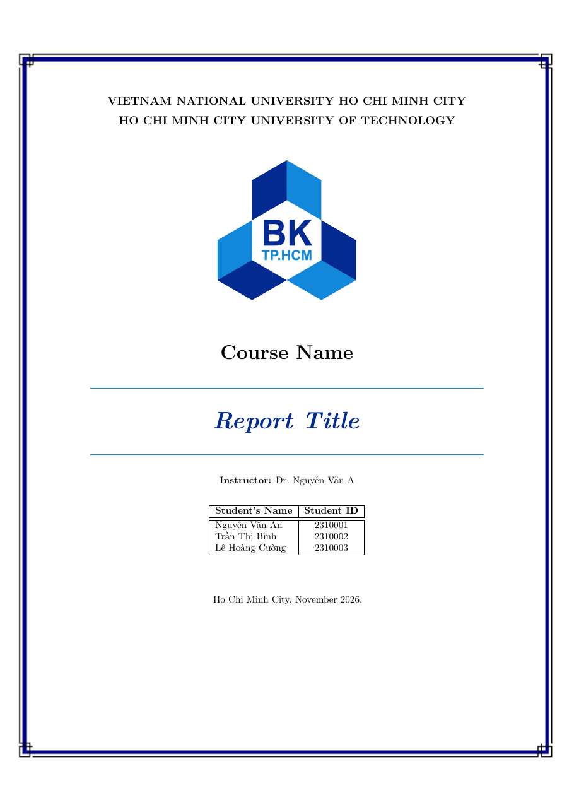
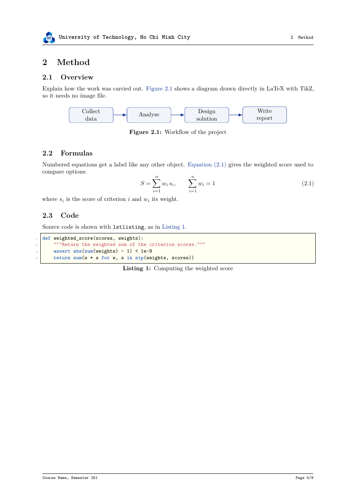
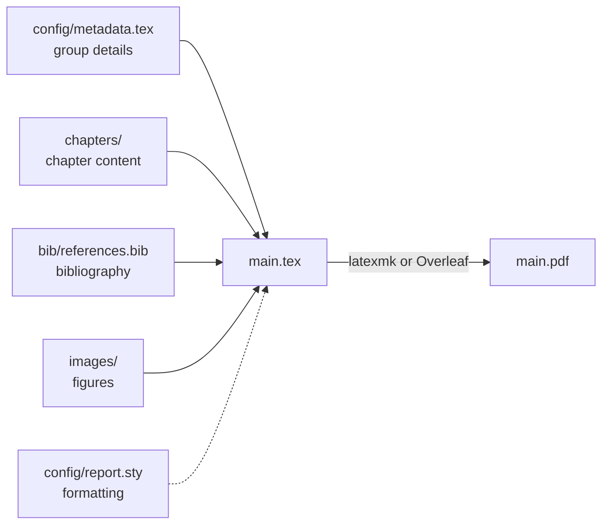

# HCMUT LaTeX Report Template

[Tiếng Việt](../vi/README.md) | **English**

A LaTeX template for group reports (assignments, course projects) in the format of Ho Chi Minh City University of Technology (HCMUT, VNU-HCM). You fill in the group's details and write the content; the cover page, member tables, table of contents, header/footer and bibliography are generated for you.

The [main README](../../README.md) is in Vietnamese; this page is its English counterpart and the entry point to the English documentation.

<div align="center">




*The cover page and a content page, built with the default English option.*

*Vietnamese build, with the `vietnamese` option: [cover page](../assets/preview-cover-vi.png) · [content page](../assets/preview-content-vi.png).*

</div>

## Features

- **HCMUT cover page**: logo, background, course name, report title, instructor, class/group and student table.
- **Members declared once**: the list appears on the cover, the workload table, the lecturer's assessment table, the declaration page and the PDF's *Author* field.
- **Two languages**: one option switches all text the template generates between English (the default) and Vietnamese ("Table 3.1" becomes "Bảng 3.1"…).
- **Drafts for the whole team**: margin notes and a DRAFT watermark, both gone in the final version.
- **References and citations**: automatic numbering, IEEE citations, list of abbreviations, lists of figures and tables, appendices.
- **Tooling**: LaTeX linting (ChkTeX), English spell checking (LTeX+), word count, automatic PDF builds on GitHub Actions.
- **Ready for AI assistants**: `AGENTS.md` tells Claude, Copilot, Cursor… which files to edit and how to avoid the common build errors.

## Quick start

**On Overleaf** (nothing to install):

1. Zip the template folder (on GitHub: **Code → Download ZIP**).
2. On [overleaf.com](https://www.overleaf.com), choose **New Project → Upload Project** and select the `.zip` file.
3. In **Menu**, check that **Compiler** is `pdfLaTeX` and **Main document** is `main.tex`.
4. Click **Recompile**.

**On your own computer**: install TeX Live and VS Code, open the template folder, install the LaTeX Workshop extension when prompted, and save `main.tex` to build. Step-by-step instructions are in [Getting started](00-getting-started.md).

> [!WARNING]
> The template only works with **pdfLaTeX**. XeLaTeX and LuaLaTeX do not work with its Vietnamese font setup.

Once it builds, edit the group's details in `config/metadata.tex` and write the chapters in `chapters/`.

## How it works

Data, content and formatting live in separate files; `main.tex` puts them together into one PDF. You only edit the four inputs with solid arrows. `config/report.sty` (dotted) is the template's built-in formatting.



## Folder structure

```text
template-latex/
├── main.tex               # Entry point: options, order of the parts
├── AGENTS.md              # Instructions for AI assistants (Claude, Copilot…)
├── config/
│   ├── metadata.tex       # Course, title, instructor, members (edit first)
│   ├── abbreviations.tex  # Abbreviations
│   ├── report.sty         # All formatting (edit only to change the look)
│   └── assets/            # University logo, cover background
├── frontmatter/           # Member page, declaration
├── chapters/              # One file per chapter: write here
├── appendices/            # One file per appendix (A, B, C…)
├── bib/references.bib     # Bibliography (BibTeX)
├── images/                # Figures, one subfolder per chapter
├── docs/                  # Documentation (vi/, en/)
└── main.pdf               # The output to submit (after the first build)
```

The remaining files (`build/`, `.latexmkrc`, `.vscode/`, `.github/`…) are generated files or tool configuration, described in [Tools](09-tools.md).

## Documentation

Every LaTeX example in these pages has been compiled against the template, so you can copy it into your report as is.

### Getting started

| Page | Covers |
| --- | --- |
| [Getting started](00-getting-started.md) | Installation, starting a new report, using an AI assistant, the pre-submission checklist |
| [Report details and cover page](01-report-info.md) | Course, title, instructor, date, members; generated tables; declaration |
| [Template options](02-options.md) | `vietnamese`, `draft`, `print`, `lists`; language-dependent text |

### Writing the report

| Page | Covers |
| --- | --- |
| [Writing text](03-writing.md) | Chapters, sections, appendices; paragraphs, special characters, lists, footnotes, links, highlight boxes |
| [Figures and tables](04-figures-and-tables.md) | Images, side-by-side images, TikZ; booktabs tables, merged cells, row colours |
| [Math and code](05-math-and-code.md) | Inline, numbered and multi-line equations; code listings, including code files |
| [Cross-references and citations](06-cross-references-and-citations.md) | `\label`, `\cref`; BibTeX, `\cite` |
| [Abbreviations](07-abbreviations.md) | `\abbreviation`, `\ac`, the list of abbreviations |
| [Teamwork](08-teamwork.md) | `\todo`/`\note` notes, splitting files, building one chapter, Git, SyncTeX |

### Tools and reference

| Page | Covers |
| --- | --- |
| [Tools: build, linting, CI](09-tools.md) | `latexmk`, LaTeX Workshop, ChkTeX, LTeX+, word count, GitHub Actions, viewing Markdown |
| [Customization](10-customization.md) | Logo, colours, font size, margins, header/footer, the template's fixed text |
| [Troubleshooting](11-troubleshooting.md) | What common error messages mean and how to fix them |
| [Cheat sheet](12-cheat-sheet.md) | The most common commands and shortcuts |

### Conventions

- Paths such as `main.tex` and `config/metadata.tex` are relative to the template's root folder.
- In LaTeX code, everything after `%` is an explanatory comment; you do not need to type it.
- The "draft" is the PDF built with the `draft` option; the "final version" is built without it.
- **Warning** boxes mark common mistakes. In VS Code they only render when the page is opened with Markdown Preview Enhanced (`Ctrl+K` then `V`); see [Viewing the Markdown docs](09-tools.md#viewing-the-markdown-docs).

## Sample report

A complete report built with this template ("A.I. in Digital Content", course Professional Skill for Engineers) lives on the branch `report/ai-digital-content`:

```sh
git switch report/ai-digital-content   # the sample report
git switch main                        # back to the template
```

## License

The template is released under the [MIT License](../../LICENSE): you may use, modify and redistribute it freely, as long as copies of the template keep the author's copyright notice.

Reports you make with the template are yours and need no license notice (see [NOTICE](../../NOTICE.md)). The university logo and the cover background belong to Ho Chi Minh City University of Technology – VNU-HCM and are not covered by this license.

Copyright (c) 2026 Tien Hung Nguyen.
